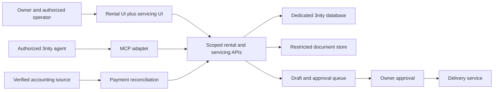

# Extension architecture

Status: mixed implementation/specification. Six MCP read tools, API-enforced reader access, approved portfolio metadata import and its owner UI are implemented. Note headers are stored in the immutable portfolio import, separate from rent. Servicing collections, loan behavior, MCP writes, followup/approval queues and notice delivery below remain specifications. See [runtime-status.md](runtime-status.md) for verified behavior.

## Runtime layout

Keep rent receivables and loan receivables distinct. A seller-finance note is not a lease with an interest field. Use a separate service/module and ledger, with shared contact and collateral references only where explicitly mapped. Reuse the rental UI and authentication framework without treating its existing rent-balance calculations as a loan engine.

## MCP surface

Start with stdio for a single private agent integration; add authenticated Streamable HTTP only when a verified consumer needs it. Avoid a public unauthenticated endpoint. Use the official MCP SDK, validate tool arguments, and call the business API rather than writing directly to MongoDB.

| Power | Proposed tools | Enforcement |
| --- | --- | --- |
| Read | `list_properties`, `get_property`, `list_tenants`, `get_lease`, `get_rent_ledger`, `list_notes`, `get_note_ledger`, `get_delinquency`, `list_followups` | Dedicated READ credential; API permits only enumerated read scopes |
| Draft / internal act | `draft_notice`, `create_followup`, `update_followup`, `propose_record_change` | Dedicated ACT credential; organization binding, audit event, idempotency key |
| Approved financial act | `record_verified_payment`, `reverse_payment`, `apply_approved_record_change` | Explicit permission, source evidence, expected record version, transactional ledger posting and readback |
| External delivery | Owner-approved dispatch of a specific notice | Recipient, rendered body, attachments, channel and record version bound to the approval; no general agent send key |

Do not expose arbitrary SQL, shell, generic HTTP requests, unrestricted collection writes, hard deletes, loan-term modification, fee waivers, or loan approval as initial MCP tools. Agents may propose changes to financial/legal terms; they do not choose those terms.

Server-side scopes must apply to REST and MCP calls equally. A READ secret must fail on POST, PATCH, DELETE, ledger writes and delivery even if an attacker bypasses the MCP adapter. Pin the 3nity organization server-side; do not trust a caller-supplied organization ID. Credentials and confidential document links must never appear in tool output or audit messages.

## Seller-finance data model

- `Note`: immutable ID, organization, borrower reference, collateral reference, executed document reference and hash, status, currency, original principal, verified opening principal and accrued interest, opening date, first due date, maturity/balloon date, interest calculation convention, contractual payment, payment frequency, allocation policy, grace/late-charge rules, escrow rules and version.
- `ScheduleVersion` / `Installment`: note and schedule version, contractual due date, scheduled principal/interest/escrow/fees, balloon amount, effective dates and source contract reference. Retain superseded versions.
- `ServicingEvent`: event ID, note, event type, effective date, posting date, amount, external payment ID, allocation rows, source evidence, idempotency key, actor, approval reference and reversal reference. Append-only; corrections are compensating events.
- `EscrowLedger`: separate tax/insurance collections, disbursements and reconciliations where the executed note requires them. Escrow is not interest income or principal reduction.
- `NoticeDraft`: note/lease reference, as-of date, ledger version/hash, template version, factual calculations, recipients, rendered preview, approval state, approval actor/time and expiry.
- `DeliveryAttempt`: approved draft/version, dispatch idempotency key, transport result, provider message ID, delivery evidence and failure disposition. Transport success does not establish legal service.
- `Followup`: linked obligation, responsible operator/agent, next action, due date, status, escalation target and outcome. Every overdue item has an owner and next action.

Store posted money as integer cents; use decimal or rational arithmetic for intermediate interest and round at the contractually defined boundary. Avoid binary floating point for money. Preserve both effective and posting dates. Define month-end, leap-year, time-zone and holiday behavior explicitly from the documents rather than assuming a universal rule.

An opening balance is a reconciled servicing position at a stated date, not original principal minus guessed payments. Require evidence for paid-through date, unapplied cash, fees, accrued interest, escrow and outstanding principal. Unknown balances remain unreconciled and cannot drive notices.

## Servicing behavior

1. Create a verified contractual schedule for fixed-rate amortizing, interest-only, and balloon structures only after each supported convention has independent test fixtures. Variable-rate, complex modifications and construction draws are out of the initial release.
2. Import and reconcile payment history. Deduplicate by source and stable external payment ID. Preserve imported facts and proposed allocations separately until approved.
3. Apply payments under the signed note's allocation rules. Support partial payments, extra principal, unapplied cash, overpayments, reversals and backdated corrections. A backdated event triggers deterministic recomputation and versioned statements, not silent edits to history.
4. Calculate due and past-due obligations as of a specified date using the verified ledger, grace rules and unresolved-payment state. Uncertain receipt evidence creates an exception, not an automatic default claim.
5. Produce statements and payoff quotes with an explicit as-of date and breakdown. Do not present a calculated quote as an approved payoff demand until it is reviewed.

## Collection workflow

A scheduled deterministic job finds changed due/overdue items and creates followups; the agent supplies context and drafts communication. No LLM is needed to calculate balances or determine dates. Notify operators when an item becomes actionable, changes materially, fails, or requires a decision; avoid repeated alerts on unchanged debt.

Start with ordinary payment reminders and statements. Default, acceleration, foreclosure, eviction and other legal notices require owner-approved templates and a separately reviewed workflow. Approval covers the exact document and recipient, not future drafts. Recheck the latest payments and ledger version immediately before dispatch; changed balances invalidate approval. Record delivered evidence and retry only after checking for an existing provider message or prior successful dispatch.

## Accounting boundary

Choose one charge generator for each obligation. Keep QuickBooks authoritative for accounting at first, with explicit cross-references to the operational ledger. Require company identity verification before accessing any accounting data. Loan principal, interest, escrow, fees and deposits remain separately classified. Accounting synchronization is a later phase with a reconciliation report and duplicate-charge prevention, not an assumption that a rent invoice can represent all note activity.
